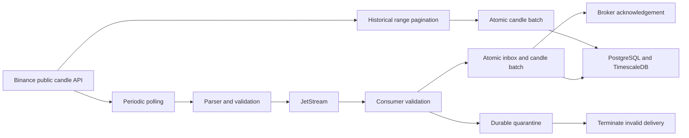

# infoSir

**A Go candle collector with explicit delivery and storage boundaries.** infoSir retrieves Binance trade-price candles, validates them, and stores them in PostgreSQL/TimescaleDB. Periodic collection passes through NATS JetStream; historical synchronization writes bounded pages directly to the same repository.

The service is useful when you need a small, inspectable collector with retryable persistence. It does not place orders, train models or claim that a successful health check proves complete market history. Its current storage contract is deliberately narrow: **one market and one interval per database**, multiple symbols.

## Data flow



Periodic polling runs once per minute and processes configured pairs sequentially. The first scheduled poll occurs after the ticker fires. `KLINE_LIMIT` controls the recent window, not the poll frequency. This is polling, not a WebSocket stream; if an outage exceeds the fetched window, an explicit historical repair is required.

Historical synchronization is disabled by default. When enabled, it starts alongside periodic collection. Its page cursor advances only after a successful database transaction. It does not publish historical pages to JetStream and does not yet persist an independent job checkpoint.

## Storage identity and guarantees

The table is named `futures_klines` for compatibility, but that name does not select the Binance market. `MARKET`, `BINANCE_BASE_URL` and `KLINES_POINT` select the source. A storage-profile row binds the database to one market/interval combination.

| Property | Current behavior |
|---|---|
| Natural key | `(symbol, time)` where time is the UTC candle open |
| Market/interval | One immutable bound profile per database |
| Values | Existing Go `float64` price/volume fields and `int64` trade count |
| Duplicated candle key | Existing row is retained with `ON CONFLICT DO NOTHING` |
| Changed candle under an existing key | No automatic replacement or revision history |
| Message identity | Durable consumer inbox plus a payload hash |
| Batch failure | Entire batch/inbox transaction rolls back |
| Successful delivery | Broker ACK occurs after the database commit |
| Permanent invalid delivery | Quarantine is stored before broker termination |

An unchanged repeated message is safe to redeliver. Reusing a message ID with different payload bytes is a conflict. If acknowledgement fails after commit, redelivery resolves against the inbox without duplicating the stored effect. These guarantees apply to persistence; they do not imply that every exchange interval was fetched.

`CONFIRM_LEGACY_PROFILE=true` is an operator assertion that the provenance of pre-existing rows has been checked. It is needed only for the first binding of a nonempty unbound database. It does not repair mixed history or validate an unknown source. A subsequent market/interval mismatch is rejected even if the flag remains true.

The current float64 model is not an exact decimal accounting representation. The service does not retain raw source responses, original lexical decimals, revision history or historic observation timestamps. Consumers needing those properties require a separate versioned storage migration.

## Candle validation and time rules

The parser checks numeric shape, finite positive OHLC prices, OHLC consistency, nonnegative volumes, integer trade counts, taker volumes not exceeding totals, duplicate rows and timestamp alignment. Zero volume and zero trades are valid. Malformed data is not silently converted to zeros.

Ranges are aligned half-open UTC intervals `[Start, End)`. Request pagination passes the current range cursor to the source and stops on missing, empty or nonadvancing pages. UTC weeks begin on Monday; calendar months use calendar boundaries rather than a fixed duration. `3d` is rejected until its source calendar is explicitly supported; USD-M `1s` is also rejected.

A bar is accepted as closed only after its expected close boundary plus a two-second local lag. This is **inferred REST closure**, not an exchange-observed finality flag or a promise that future corrections are impossible. Keep host time synchronized. Later corrected values are not inserted as revisions under the current schema.

## Quick start with local development containers

Requirements: Docker with Compose, network access to the configured public market endpoint, and locally supplied secrets. The included development stack runs TimescaleDB, file-backed JetStream and infoSir. It exposes only the HTTP status port on host loopback; database and broker are reachable inside the Compose network.

Create an untracked local environment file from the example and edit it before startup:

```sh
cp .env.dist .env
# Set a nonempty DB_PASS and a URL-safe NATS_TOKEN in .env.
# Select one complete market profile and review PAIRS and KLINE_INTERVAL.
docker compose up --build
```

`.env.dist` currently demonstrates USD-M, while defaults in application configuration and Compose are Spot. Set all three source fields together; copying only `MARKET=usdm` leaves an inconsistent profile.

| Profile | MARKET | BINANCE_BASE_URL | KLINES_POINT |
|---|---|---|---|
| Spot trade candles | `spot` | `https://api.binance.com` | `api/v3/klines` |
| USD-M trade candles | `usdm` | `https://fapi.binance.com` | `fapi/v1/klines` |

Compose passes the configured password/token to the relevant development containers. These environment values are visible to local Docker administrators; this is not a production secret-management system. The application image does not contain `.env` and runs as a non-root application user.

```sh
curl --fail http://127.0.0.1:8080/healthz
curl --fail http://127.0.0.1:8080/readyz
docker compose logs --tail=100 infosir
```

`/healthz` reports process liveness. `/readyz` checks database connectivity and NATS connection state. Neither endpoint certifies freshness, continuous coverage, successful aggregate refresh, or complete historical synchronization.

## Run the Go application against existing dependencies

Use Go 1.23.4 or a compatible toolchain, a Timescale-enabled database and a JetStream-enabled NATS server. Run from the repository root so the default migration directory resolves correctly.

```sh
go mod download
go test ./...
go vet ./...
go run ./cmd
```

The application loads an optional `.env`, then environment configuration. It validates configuration, opens the database, applies migrations, binds the storage profile, checks/creates broker resources and starts workers plus HTTP status endpoints. Startup performs SQL migrations and therefore needs the corresponding privileges in this version; migration-role separation is a later deployment improvement.

The native process binds HTTP to `:HTTP_PORT` on all available interfaces. Restrict exposure through host/network configuration if needed. The Compose mapping is explicitly loopback-only. There is no authenticated administrative HTTP API in this release.

## Configuration reference

| Setting | Default / requirement | Meaning |
|---|---|---|
| `DB_HOST`, `DB_PORT` | `localhost`, `5432` | PostgreSQL endpoint |
| `DB_USER`, `DB_NAME` | `root`, `infosir_db` | Explicit dedicated deployment values are recommended |
| `DB_PASS` | Required, no usable default | Database password |
| `DB_SSLMODE` | `disable` | `disable`, `require`, `verify-ca`, `verify-full`; select for the actual deployment |
| `MIGRATIONS_PATH` | `internal/db/migrations` | Filesystem migrations; image uses `/app/migrations` |
| `NATS_URL` | Required | Broker URL with credentials when enabled; do not print it |
| `NATS_SUBJECT` | `infosir_kline` | Concrete subject, no wildcards |
| `JETSTREAM_STREAM_NAME` | `infosir_kline_stream` | File-backed stream identity |
| `JETSTREAM_CONSUMER` | `infosir_kline_consumer` | Durable consumer identity |
| `MARKET` | `spot` | `spot` or `usdm` |
| `BINANCE_BASE_URL`, `KLINES_POINT` | Spot values | Must describe the same market as `MARKET` |
| `PAIRS` | Required comma-separated list | For example `BTCUSDT,ETHUSDT` |
| `KLINE_INTERVAL` | `1m` | Supported UTC interval |
| `KLINE_LIMIT` | `10`, range 1–1000 | Recent candles per periodic request |
| `SYNC_ENABLED` | `false` | Start historical repair at startup |
| `SYNC_START` | Optional RFC3339 | Explicit aligned start; required for an empty series when sync is enabled |
| `CONFIRM_LEGACY_PROFILE` | `false` | First binding assertion for existing unbound rows |
| `HTTP_PORT` | `8080` | Status HTTP server port |
| `APP_ENV`, `LOG_LEVEL` | `dev`, `debug` | Application labels/log configuration |

Changing symbols within the same profile is supported. Changing market or interval requires a separate database or an explicit schema/data migration; changing only an environment variable is rejected.

## Historical synchronization

Set an explicit aligned start for the initial load, for example in the untracked environment:

```dotenv
SYNC_ENABLED=true
SYNC_START=2024-01-01T00:00:00Z
```

The end boundary is fixed at job start using the latest locally inferred closed interval. `SYNC_START` takes precedence over stored rows. Without it, the latest stored row is replayed as a recovery overlap; an empty series fails with a request for `SYNC_START`. The latest timestamp is **not** evidence that all earlier intervals exist.

The startup historical path requests up to 720 bars per page, spaces pages by at least 200 ms, and uses bounded retry/backoff for eligible source failures. A gap, invalid payload, database error or exhausted page budget stops synchronization. A fatal historical-sync error terminates the current application run through its lifecycle handler; it is not just an informational log.

On restart there is no independent durable page checkpoint. Repeated ranges are tolerated by the natural key, but old gaps may remain unless explicitly included in the requested start range. A source correction under an existing key retains the original row. Do not interpret a completed invocation as a revision-aware or global completeness certificate.

## JetStream message protocol

The message body is a JSON array of the existing candle model. Required headers:

```text
Infosir-Schema: 1
Infosir-Market: spot | usdm
Infosir-Interval: configured interval
Nats-Msg-Id: stable message identity
```

The built-in producer derives a SHA-256 identity from market, interval and exact body bytes. Consumers accept at most 1 MiB and 1500 candles, reject unknown JSON fields/trailing JSON, validate the profile and bars, then commit inbox and data together. Stable message bytes and identity must be retained when implementing another producer.

Permanent rejects include incompatible envelopes, invalid JSON/bars, duplicate candle keys within a message, open/unaligned bars and changed payload under the same message identity. The consumer writes a quarantine record before `Term`. If quarantine storage fails, the message is retried. Oversized rejects retain bounded digest/size evidence rather than an unlimited database blob. Quarantine has no automatic replay/delete command; review the reason and repair the source/protocol before constructing an intentional new delivery.

A newly created stream uses file storage, Limits retention, DiscardNew, a 1 GiB bound and 1 MiB message limit. It does not evict old messages by age. This prevents silent eviction as the default response to capacity, but requires explicit retention/capacity operations: with Limits retention, acknowledged messages are not automatically removed just because the consumer ACKed them. A full stream rejects new publications; monitor failures and maintain storage deliberately.

The durable consumer is explicitly created and subsequently bound, so drain does not delete its server-side state. It uses explicit acknowledgements, a 30 s acknowledgement window and at most 64 pending acknowledgements. Existing incompatible stream/consumer configurations are rejected instead of being silently rewritten. Broker deduplication alone is insufficient; the database inbox is part of recovery state.

## Migrations and cutover from an older deployment

The migration set includes the base candle hypertable, continuous aggregate views (`15m`, `30m`, `1h`, `4h`, `1d`) and profile/inbox/quarantine tables. Migrations 0001–0002 require TimescaleDB. Aggregate names do not certify completeness: a bucket may contain missing base bars, refresh policies cover limited historical windows, and a target interval smaller than the configured base interval cannot reconstruct missing detail. Validate aggregate use for the chosen base profile and explicitly refresh old imported ranges when appropriate.

For an existing deployment:

1. Back up the database and broker state and verify which market/interval produced the history.
2. Stop old writers. Do not let headerless and profile-aware workers race on the same durable identity.
3. Review database migrations and profile binding. Set `CONFIRM_LEGACY_PROFILE=true` only when the existing profile is known.
4. Prefer a new versioned subject/stream/consumer for the protocol cutover. Retain the old stream for inspection; old headerless messages will otherwise be quarantined.
5. Start the upgraded worker on a bounded range, inspect persisted rows/inbox/quarantine and exercise a restart before expanding the universe.
6. Preserve inbox and consumer state during rollback/recovery. Removing them changes duplicate-delivery behavior; export required evidence before any destructive operation.

SIGINT/SIGTERM stops producers, waits for jobs, drains accepted consumer work and then closes database resources. Forced shutdown can leave an uncertain acknowledgement or transaction outcome; recovery uses idempotent storage and redelivery rather than assuming nothing happened.

## Verification and its limits

```sh
# Default fixture/unit tests.
go test ./...
go vet ./...

# Disposable PostgreSQL only; tests create an isolated schema.
INFOSIR_TEST_DSN='your-disposable-test-dsn' go test -race ./...

# Also exercise real redelivery/drain against a temporary local NATS process.
# A nats-server executable must be installed.
INFOSIR_TEST_DSN='your-disposable-test-dsn' \
INFOSIR_NATS_INTEGRATION=1 go test -race ./...
```

Tests cover range query bounds, strict parsing, integer precision, duplicate detection, inferred closure, calendar handling, retries/cancellation, no cursor advance after failed writes, atomic batch/inbox rollback, concurrent redelivery, profile mismatch, quarantine and durable consumer drain. External integration tests explicitly skip without their environment switches. PostgreSQL tests emulate the base table without validating Timescale continuous aggregate installation; a passing unit run does not certify those migrations or a production restore.

## Troubleshooting

| Symptom | First useful check |
|---|---|
| Startup profile mismatch | Compare `infosir_storage_profile` with `MARKET`/`KLINE_INTERVAL`; do not bypass by deleting the profile |
| Empty-history sync failure | Supply an aligned `SYNC_START` and confirm source profile |
| Ready endpoint succeeds but bars are missing | Inspect job/publish logs, source range and actual per-interval coverage; connectivity is not completeness |
| Message is repeatedly redelivered | Check DB availability, transaction error and inbox state; an ACK error after commit can be recovered normally |
| Quarantine grows | Group by reason code and inspect the producer envelope/validation; do not acknowledge unreviewed invalid data as good |
| Publications fail when broker fills | Check stream capacity/retention and backfill requirements before removing data |
| Aggregate history is absent or stale | Inspect Timescale refresh policy/window and base-bar completeness |

## Development layout

`pkg/crypto` implements the source adapter/parser; `internal/srv` defines service and interval/range boundaries; `internal/jobs` schedules periodic/historical work; `pkg/nats` owns the wire envelope and acknowledgement order; `internal/db/repository` owns atomic writes and inbox/quarantine; `cmd` wires startup/shutdown and configuration.

Future extensions should preserve these ownership boundaries. Revision-aware storage, raw evidence, durable job checkpoints, multiple market/interval identities and a typed command API require explicit schemas and migration tests; adding a field to the JSON body alone does not implement those guarantees.


## Technologies Used

| Component     | Tech Stack               |
|---------------|--------------------------|
| Language      | Go 1.23 (Alpine)         |
| Database      | PostgreSQL + TimescaleDB |
| Queue         | NATS + JetStream         |
| Migrations    | golang-migrate           |
| Scheduler     | Custom cron-like jobs    |
| Logger        | Uber Zap                 |
| Deployment    | Docker + Docker Compose  |

---

## Project Structure

```text
infosir/
├── cmd/main.go             # Application entrypoint
├── cmd/config/             # Environment configs (dotenv)
├── internal/
│   ├── db/                 # DB init, migrations, repository
│   │   ├── migrations/     # TimescaleDB schema & views
│   ├── jobs/               # Historical sync & scheduler
│   ├── srv/                # Service logic
│   ├── utils/              # Logger & helpers
├── pkg/                    # External integrations
│   ├── crypto/             # Binance API client
│   ├── nats/               # NATS & JetStream client
├── Dockerfile
├── docker-compose.yml
├── .env
```


## Authors

- Kyrylo Malovychko ([@katalvlaran](https://github.com/katalvlaran)) – design, architecture, orchestration

---

## Benchmarks & Performance

> Coming soon with full logs, request throughput, and resource profiling.

---

## Last updated: 2026-11-06
